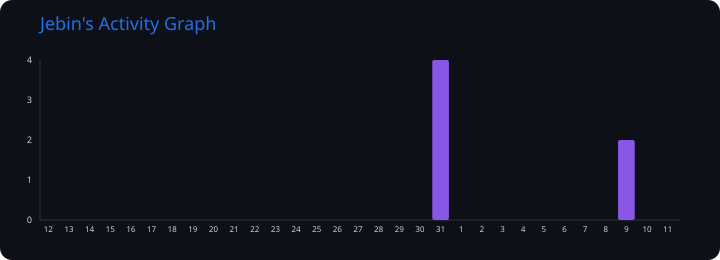

<div align="center">


<br/>

<picture>
  <source media="(prefers-color-scheme: dark)" srcset="https://readme-typing-svg.demolab.com?font=EB+Garamond&weight=700&size=38&duration=3500&pause=1000&color=F6F7F9&center=true&vCenter=true&width=700&lines=Hi%2C+I+am+Jebin!">
  
</picture>


<br/>

<a href="https://mail.google.com/mail/?view=cm&fs=1&to=jebinabraham1804@gmail.com&su=Hello%20from%20GitHub" target="_blank"></a>
<a href="https://www.linkedin.com/in/jebinabraham2005"></a>
<a href="https://jebinabraham.vercel.app"></a>

</div>

<br/>

## Who I am

I'm an AI engineer who likes owning the whole pipeline — fine-tuning the model, wiring up the
multi-agent reasoning loop, and building the responsive interface a real person actually touches.
Most of my work sits at the intersection of **LLMs, retrieval and applied deep learning**, with a
soft spot for problems specific to my part of the world: Tamil-language AI, citizen access to
government services, and energy systems.

```python
class JebinAbraham:
    def __init__(self):
        self.role      = "AI Engineer"
        self.education = "B.Tech CSE (Artificial Intelligence) @ Karunya Institute of Technology & Sciences, '27"
        self.based_in  = "Coimbatore, Tamil Nadu, India"
        self.building  = ["Agentic AI systems", "RAG pipelines", "Vision & NLP models"]
        self.currently = "Shipping AI features into production at Airman Aeronautics"

    def philosophy(self) -> str:
        return "Research insight is only worth as much as the system you ship it in."
```

<br/>

*🧵 Thread of thought:*

What keeps me in this field isn't the novelty of a new model release — it's watching a prototype
survive contact with real users. Right now that means pushing on how far a **retrieval-augmented
agent** can go before it needs a fine-tuned domain model, and where multi-agent evaluation still
falls short for low-resource languages like Tamil.

<br/>

If your world revolves around LLMs, agents and shipping real products, we're already on the same
wavelength. I can also build your next idea.

So why wait? Let's connect — badges above, or just say hi.

---

## 🛠️ Tech Arsenal

<div align="center">

**Languages**

[](https://www.python.org/)&nbsp;&nbsp;
[](https://www.java.com/)&nbsp;&nbsp;
[](https://developer.mozilla.org/en-US/docs/Web/JavaScript)&nbsp;&nbsp;
[](https://www.typescriptlang.org/)&nbsp;&nbsp;
[](https://developer.mozilla.org/en-US/docs/Web/HTML)&nbsp;&nbsp;
[](https://developer.mozilla.org/en-US/docs/Web/CSS)&nbsp;&nbsp;

**AI · Machine Learning · Deep Learning**

[](https://pytorch.org/)&nbsp;&nbsp;
[](https://www.tensorflow.org/)&nbsp;&nbsp;
[](https://scikit-learn.org/)&nbsp;&nbsp;
[](https://opencv.org/)&nbsp;&nbsp;

<a href="https://www.langchain.com/"></a>
<a href="https://www.langchain.com/langgraph"></a>
<a href="https://www.crewai.com/"></a>
<a href="https://microsoft.github.io/autogen/"></a>
<a href="https://huggingface.co/"></a>
<a href="https://haystack.deepset.ai/"></a>
<a href="https://docs.pydantic.dev/"></a>


**Vector Databases & Search**

<a href="https://www.pinecone.io/"></a>
<a href="https://www.trychroma.com/"></a>
<a href="https://weaviate.io/"></a>
<a href="https://github.com/facebookresearch/faiss"></a>
<a href="https://milvus.io/"></a>
<a href="https://qdrant.tech/"></a>

**Web · Data · Infrastructure**

[](https://react.dev/)&nbsp;&nbsp;
[](https://nextjs.org/)&nbsp;&nbsp;
[](https://fastapi.tiangolo.com/)&nbsp;&nbsp;
[](https://www.postgresql.org/)&nbsp;&nbsp;
[](https://www.mysql.com/)&nbsp;&nbsp;
[](https://www.mongodb.com/)&nbsp;&nbsp;
[](https://www.sqlite.org/)&nbsp;&nbsp;
[](https://www.docker.com/)&nbsp;&nbsp;
[](https://aws.amazon.com/)&nbsp;&nbsp;
[](https://cloud.google.com/)&nbsp;&nbsp;
[](https://git-scm.com/)&nbsp;&nbsp;
[](https://github.com/)&nbsp;&nbsp;
[](https://www.linux.org/)&nbsp;&nbsp;

</div>

---

## 🚀 Featured Projects

| Project | Description | Tech Stack | Live Demo | Repository |
|---|---|---|---|---|
| **SIVI** | Bilingual Tamil + English RAG chatbot answering citizen queries about Tamil Nadu government schemes — so language is never the barrier to a benefit someone qualifies for. | Python, LangChain, RAG, Vector DB |  | <a href="https://github.com/Jebin-05/SIVI"></a> |
| **ZeroDay-DRL** | Deep reinforcement learning agent for zero-day botnet detection — learning to flag malicious network behaviour it has never seen a signature for. | Python, Deep RL, PyTorch |  | <a href="https://github.com/Jebin-05/ZeroDay-DRL"></a> |
| **AI-Chef** | Intelligent food analyzer powered by vision-language models — upload a food image and get ingredients, step-by-step recipes and a full nutritional breakdown. | Python, VLM, GenAI |  | <a href="https://github.com/Jebin-05/AI-Chef"></a> |
| **MPC Smart Grid** | Model Predictive Control system for intelligent power management across solar, battery and grid sources — optimisation meeting real energy constraints. | Python, Control, Optimization |  | <a href="https://github.com/Jebin-05/MPC-Smart-Grid-Energy-Management"></a> |
| **Adaptive Spectral-Depth Fusion** | Salt-deposit detection in seismic imagery via spectral–depth fusion and hybrid ensemble learning, with a companion [PINNs](https://github.com/Jebin-05/PINNs) approach. | Python, Computer Vision, Ensemble ML |  | <a href="https://github.com/Jebin-05/Adaptive-Spectral-Depth-Fusion-with-Hybrid-Ensemble-Learning"></a> |
| **Prompt It Right** | Gamified prompt-engineering platform — interactive challenges scored live against real models, with separate admin and participant dashboards. | TypeScript, React, Vite, LLM |  | <a href="https://github.com/Jebin-05/Mindkraft"></a> |
| **Portfolio** | Personal portfolio site — advanced animations and interactive components for a fast, responsive presentation of my work. | React, Vite, Tailwind CSS | <a href="https://jebinabraham.vercel.app"></a> | <a href="https://github.com/Jebin-05/Portfolio"></a> |

> **🔬 In the lab:** a **Journal Paper Assistant** — an open-source alternative to jenni.ai with a
> LangChain reviewing agent that validates research papers before submission (and drafts them from
> scratch) — plus an **R&D Paper Evaluation System** using multi-agent reasoning to score papers on
> quality, relevance and novelty.

---

## 💼 Where I've Been Building

```text
 2026 · May ─── now    AI/ML Engineer, Intern            Airman Aeronautics
                       Shipping AI-enhanced features into production apps and embedding
                       ML models directly into existing engineering workflows.

 2025 · Oct ─── now    Frontend Developer, Intern        Reflexlabs AI
                       Responsive, high-performance React / Next.js interfaces built
                       with design and backend teams — production-ready, cross-browser.

 2024 · Dec ─── now    Generative AI Engineer, Trainee   Karunya Innovation & Design Studio
                       Generative AI solutions in Python with PyTorch and LangChain,
                       built under institutional hackathon pressure.

 2025 · Jun ─── Aug    Frontend Developer, Intern        Computer Technology Centre, Karunya
                       Built the AIML department's interactive website in React + JS.

 2024 · Jun ─── Jul    Generative AI Engineer, Intern    Postulate Info Tech Pvt Ltd
                       Fine-tuned pre-trained language models for domain-specific use,
                       lifting output relevance for downstream tasks.
```

---

## 📊 Stats

<div align="center">

[](https://github.com/Jebin-05)

<br/>


</div>

---

## 📈 Activity

<div align="center">



</div>

<br/>

## 🐍 Contribution Squares

<div align="center">

<picture>
  <source media="(prefers-color-scheme: dark)" srcset="https://raw.githubusercontent.com/Jebin-05/Jebin-05/main/dist/github-contribution-grid-snake-dark.svg">
  <source media="(prefers-color-scheme: light)" srcset="https://raw.githubusercontent.com/Jebin-05/Jebin-05/main/dist/github-contribution-grid-snake.svg">
  
</picture>

</div>

---

## 🏆 Achievements

<div align="center">


| | |
| :---: | :--- |
| 🥈 | **2nd Prize — Startup TN Thamizhi Hackathon** &nbsp;·&nbsp; Tamil-language AI for citizen access to government services |
| 🎓 | **B.Tech CSE (Artificial Intelligence)** &nbsp;·&nbsp; Karunya Institute of Technology & Sciences &nbsp;·&nbsp; 2023 – 2027 |
| ⚡ | GitHub **YOLO** and **Quickdraw** badges |

</div>

---

<div align="center">

<i>"Research insight is only worth as much as the system you ship it in."</i>


</div>
